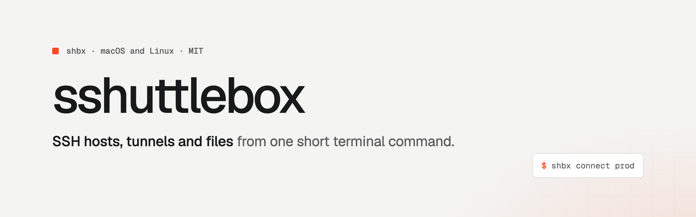
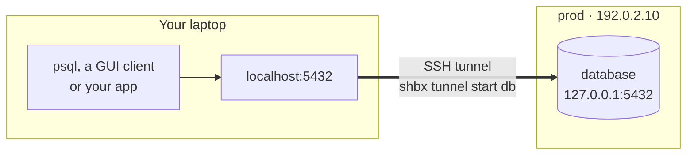
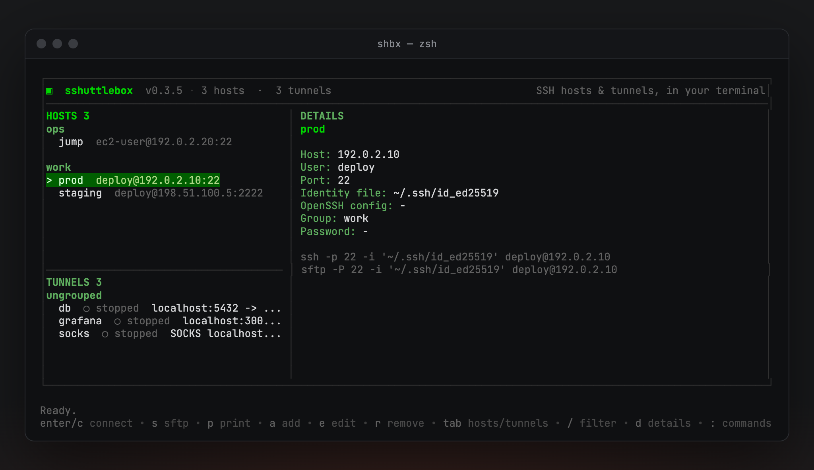

<a href="https://itaprac.github.io/sshuttlebox/">
  <picture>
    <source media="(prefers-color-scheme: dark)" srcset=".github/assets/banner-dark.png">
    
  </picture>
</a>

<p>
  <a href="https://github.com/itaprac/sshuttlebox/actions/workflows/ci.yml"></a>
  <a href="https://github.com/itaprac/sshuttlebox/releases"></a>
  <a href="go.mod"></a>
  <a href="LICENSE"></a>
  
  <a href="https://itaprac.github.io/sshuttlebox/"></a>
</p>

**sshuttlebox** (`shbx`) is a small SSH host and tunnel manager for macOS and Linux.
You save each server once under a short name; after that, connecting, forwarding a port or
copying a file is one short command — or a keypress in its terminal UI.

```bash
go install github.com/itaprac/sshuttlebox/cmd/shbx@latest
```

| Without shbx | With shbx |
| --- | --- |
| `ssh -p 2222 deploy@198.51.100.5` | `shbx connect staging` |
| `ssh -N -L 5432:127.0.0.1:5432 deploy@192.0.2.10` | `shbx tunnel start db` |
| `sftp deploy@192.0.2.10`, then `get /var/log/app.log` | `shbx sftp get prod /var/log/app.log ./app.log` |

Not sure what it will run? Add `--dry-run` and shbx prints the exact command instead.

## A tour in five commands

**1 · Bring the servers you already have.** Aliases from `~/.ssh/config` become saved hosts.

```console
$ shbx import ssh-config --dry-run
$ shbx import ssh-config
```

**2 · Or add one by hand.**

```console
$ shbx add prod --host 192.0.2.10 --user deploy --identity-file ~/.ssh/id_ed25519 --group work
Added host "prod"
```

**3 · Connect by name.** Add `--dry-run` to see the exact `ssh` line first.

```console
$ shbx connect prod --dry-run
ssh -p 22 -i '~/.ssh/id_ed25519' deploy@192.0.2.10
```

**4 · Open a tunnel by name.** Say the database on `prod` only listens on `127.0.0.1:5432`, so
it cannot be reached from outside. A local tunnel makes it appear on your own machine:
anything that connects to `localhost:5432` on your laptop is carried over SSH to port 5432 on
`prod`.

```console
$ shbx tunnel add db --host prod --local-port 5432 --remote-host 127.0.0.1 --remote-port 5432
$ shbx tunnel start db
```



`shbx tunnel stop db` closes it again. A SOCKS tunnel (`--dynamic-port 1080`) works the same
way for a whole network instead of one port.

**5 · Or do all of it from the terminal UI.** Run `shbx` with no arguments.



| Key | Action | Key | Action |
| :---: | --- | :---: | --- |
| <kbd>enter</kbd> | connect | <kbd>tab</kbd> | hosts ↔ tunnels |
| <kbd>s</kbd> | SFTP | <kbd>/</kbd> | filter |
| <kbd>e</kbd> | edit | <kbd>d</kbd> | details |
| <kbd>a</kbd> | add | <kbd>:</kbd> / <kbd>ctrl</kbd>+<kbd>p</kbd> | command palette |

## Everything else it does

| | |
| --- | --- |
| **SFTP** | `shbx sftp prod` for a session; `shbx sftp ls\|get\|put` for one-off transfers |
| **Tunnel types** | local (`--local-port`), remote, and SOCKS (`--dynamic-port 1080`) |
| **Groups** | `shbx group add work`, then `--group work` on hosts and tunnels |
| **Doctor** | `shbx doctor` checks config, SSH, keys and tunnels; `--fix` repairs what is safe; `--json` for scripts |
| **Export** | `shbx export ssh-config --output ~/.ssh/config.d/shbx` writes OpenSSH config back out |
| **Backups** | `shbx config backup`, `shbx config restore FILE --dry-run` |
| **Completion** | `shbx completion install --shell all` for bash, zsh and fish |
| **Passwords** | optional; passed through an OpenSSH auth helper, stored in the local config (keys are better) |

Full list: `shbx help`.

## Where your data lives

One JSON file, `~/.config/sshuttlebox/config.json`. New config files, backups and exports use
mode `0600`. `shbx config path` prints the path, `shbx config status` shows counts and warnings.

> [!IMPORTANT]
> Saved passwords are stored in that file. Use SSH keys where you can;
> `shbx doctor` warns while any host still has a saved password.

<details>
<summary><b>How updates stay safe</b></summary>

- Config and tunnel state are written through private atomic files and locks. Edits from two
  terminals are merged; two edits of the same entry fail with a conflict message. In the TUI,
  cancel the form and press `ctrl+r` to reload.
- A config load error blocks writes until a reload succeeds.
- Stop a tunnel before changing its name, host or forwarding settings. `tunnel remove --yes`
  refuses a running tunnel; `--force` stops it and confirms before removing.
- `shbx tunnel stop NAME` works even when the config entry is gone. Legacy state that holds only
  a PID cannot be matched safely: stop that process yourself, then run `shbx doctor --fix`.
- Unattended connections need an already trusted host key; connect interactively once to accept it.
- Imported OpenSSH entries keep pointing at the original file, so `Include`, `Match`,
  `ProxyJump` and wildcard defaults still apply when you connect. Explicit shbx user, port and
  key edits override them; patterns and dynamic `Include` paths cannot always be listed, so
  import warns about them.
- In the TUI, `unknown` means a status check failed, not that the tunnel is stopped.
- `shbx doctor` exits with code 1 when a check fails; warnings alone do not.

</details>

<details>
<summary><b>Shell completion paths</b></summary>

| Shell | Path |
| --- | --- |
| bash | `~/.local/share/shbx/completions/bash/shbx` |
| zsh | `~/.local/share/shbx/completions/zsh/_shbx` |
| fish | `~/.config/fish/completions/shbx.fish` |

`shbx completion bash|zsh|fish` prints the script to stdout instead.

</details>

## Install options

Go 1.22 or newer, on macOS or Linux.

<details>
<summary><b>go install</b></summary>

```bash
go install github.com/itaprac/sshuttlebox/cmd/shbx@latest
export PATH="$HOME/go/bin:$PATH"   # if your Go bin folder is not on PATH yet
```

</details>

<details>
<summary><b>From source</b></summary>

```bash
git clone https://github.com/itaprac/sshuttlebox.git
cd sshuttlebox
go build -o shbx ./cmd/shbx
```

</details>

## Hacking on it

```bash
go test -race ./...
go vet ./...
go run ./cmd/shbx help
```

<details>
<summary><b>OpenSSH integration test</b></summary>

Runs a local password-only SFTP server with temporary files and fake credentials; your SSH
config is left alone. Needs Python 3.12 and Paramiko 5.0.0:

```bash
go build -o /tmp/shbx-test ./cmd/shbx
python3 -m venv /tmp/shbx-test-venv
/tmp/shbx-test-venv/bin/pip install paramiko==5.0.0
/tmp/shbx-test-venv/bin/python tests/integration/ssh_password.py /tmp/shbx-test
```

On current macOS, Go 1.22 tests need `-ldflags=-linkmode=external`; stable Go does not.
CI runs Go 1.22 and stable Go on macOS and Linux with race detection, static analysis,
a reachable-vulnerability scan, and OpenSSH password auth and transfers.

</details>

## Contributing

Issues and pull requests are welcome. For larger changes, open an issue first so we can talk it
through. Released under the [MIT licence](LICENSE).
